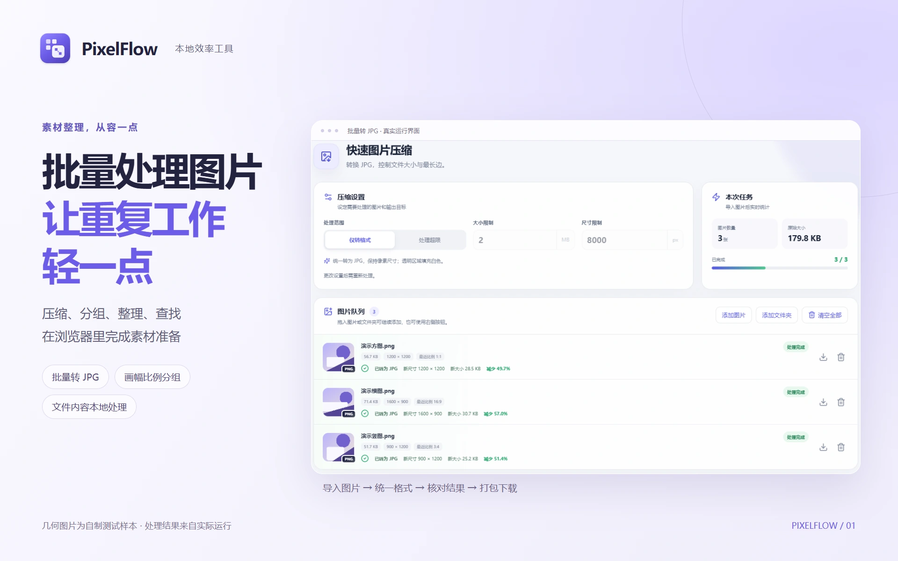
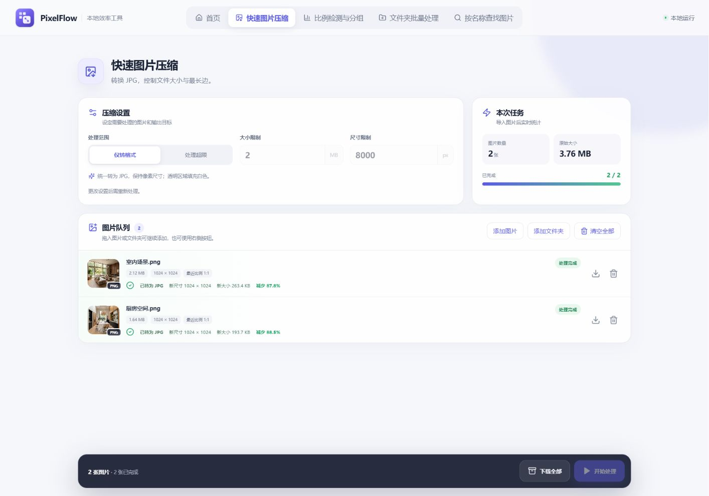
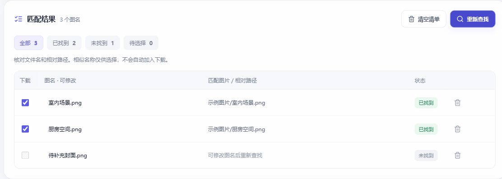

# PixelFlow · 本地效率工具




[造物集正式宣传素材、来源与功能边界](docs/portfolio-assets/README.md) · [素材清单 manifest](docs/portfolio-assets/manifest.json)


PixelFlow 是一个在浏览器中运行的本地工具箱，提供图片压缩、画幅比例检测与分组、文件夹批量处理，以及按名称查找图片。图片和表格内容在设备本地处理，无需上传到服务器。


## 功能

### 快速图片压缩

- 拖放图片或文件夹，批量导入 JPG、JPEG、PNG、WebP、TIFF。
- “仅转格式”将非 JPG 图片转换为 JPG；“处理超限”按文件大小和最长边限制判断是否需要压缩，默认大小限制为 2 MB。
- 保持图片宽高比，透明区域填充白色；需要缩小时最多再尝试 3 次缩小像素并编码。
- 队列显示文件大小、尺寸、处理状态和结果；支持单张下载与打包下载。
- 两个图片工具共用队列，重复选择同一图片时只保留一份；追加图片不会重新处理已完成任务。



图中两张公开演示图片实际由 2.12 MB、1.64 MB 转为 263.4 KB、193.7 KB 的 JPG；这是具体样本结果，不代表平均压缩率或处理性能。

### 比例检测与分组

- 读取图片尺寸、方向、文件大小和实际宽高比，匹配最接近的标准比例并显示误差。
- 与快速图片压缩共用 14 种标准比例：1:1、16:9、9:16、4:3、3:4、3:2、2:3、5:4、4:5、21:9、1:4、4:1、1:8、8:1。
- 按比例自动分组，可复制检测结果、导出 CSV，或下载单个及全部分组。
- 下载时可保留原图，也可按大小与最长边限制处理超限图片；默认大小限制与快速压缩工具一致。

### 文件夹批量处理

- **AIGC 专用**：粘贴单行或多行 Excel/WPS 需求表，默认读取第 1 列的需求名称和第 12 列的需求类型。按 `【AI】创建日期-需求名称-需求类型` 命名，创建日期使用实际创建当天的北京时间（`YYYY-MM-DD`），并生成“AI”“原图”子文件夹。
- AIGC 列选择范围跟随当前表格的实际列数，可切换需求名称列和需求类型列；没有手动表头开关，明确的需求名称/需求类型表头自动跳过。预览显示需求名称、需求类型、文件夹名称和状态；可修正名称及类型，缺失时需补全后创建。支持带分隔行的 Markdown 表格，不再从需求说明推测类型。
- **普通文件夹工具**：每行输入一个名称，统一添加前缀、后缀或编号，预览后批量创建文件夹。
- 创建前检查重复名称并清理 Windows 不允许的文件夹名称字符；只在用户选择并授权的目标目录中操作。

### 按名称查找图片

- 上传 `.xlsx` 表格并选择工作表和图名列，或粘贴每行一个图名的文字；清单支持修改、删除和重复项提示。
- 点击“选择图片文件夹”，在 Windows 选择窗口底部的“文件夹”输入框中粘贴 UNC 共享路径，再点击“上传”并确认授权。每次选择一个目录，可通过“添加图片文件夹”继续累加，统一检索各目录及其子目录；支持单独移除目录。
- 文件夹选择统一使用普通目录导入。系统窗口的“上传”仅代表把文件交给本地页面读取，图片内容不上传到网站服务器；浏览器原生确认框的文字由浏览器决定。
- “图片目录”卡片在标题下突出说明系统“上传”提示的含义，并显示各目录图片数量。同名目录以编号区分；名称及文件清单相同会提示核对，不会仅凭同名目录自动丢弃。网页不会自动读取剪贴板路径。
- 带扩展名按完整文件名查找，不带扩展名按名称查找；多个同名文件及相似候选需要人工核对。
- ZIP 保留图片原始内容、格式、来源目录及内部层级。添加或移除目录后，已有匹配结果自动刷新，需重新核对下载选择。任何选中图片读取失败时不生成缺图的压缩包，可重试或取消勾选。
- 切换工具后保留当前清单和匹配结果；刷新页面后需重新选择目录。真实共享目录能否访问，以 Windows 权限和浏览器实际选择结果为准。



查找演示使用独立目录中的两张公开演示图片及一项不存在的图名，实际结果为两项找到、一项未找到；没有读取真实共享目录。

## 品牌与展示素材

产品标志的唯一母版为 [public/pixelflow.svg](public/pixelflow.svg)，导航、浏览器图标和 README 共用它。图形由三个像素汇入画幅，保留靛紫识别，以轻材质与边缘光表达层次。

真实首页、功能与手机截图维护在 `docs/images/`，本批截图已同步正式图标。README 展示首页、压缩界面与查找结果，作品集使用对应宽窄取景。素材目录、实际尺寸、来源版本和复现边界见 [品牌与展示素材](docs/brand/README.md)；不改写处理数字或模拟不存在的功能。

## 产品统计

已增加匿名业务埋点、Cloudflare Pages Functions 接口、D1 数据表及 `/admin` 统计后台。采集仅在正式站点启用，文件内容仍在本地处理。数据库配置、统计口径和部署流程见 [统计系统说明](docs/analytics-setup.md)。本地构建通过不代表线上数据库已开通，部署前需完成对应账户权限与绑定。

## 本地运行

```bash
npm install
npm run dev
```

运行后打开终端显示的本地地址。批量创建文件夹需要支持文件系统访问的新版 Chrome 或 Edge。

## 测试与构建

```bash
npm run test
npm run build
```

构建结果位于 `dist`。部署到 Vercel 等静态托管平台时，构建命令为 `npm run build`，输出目录为 `dist`。
