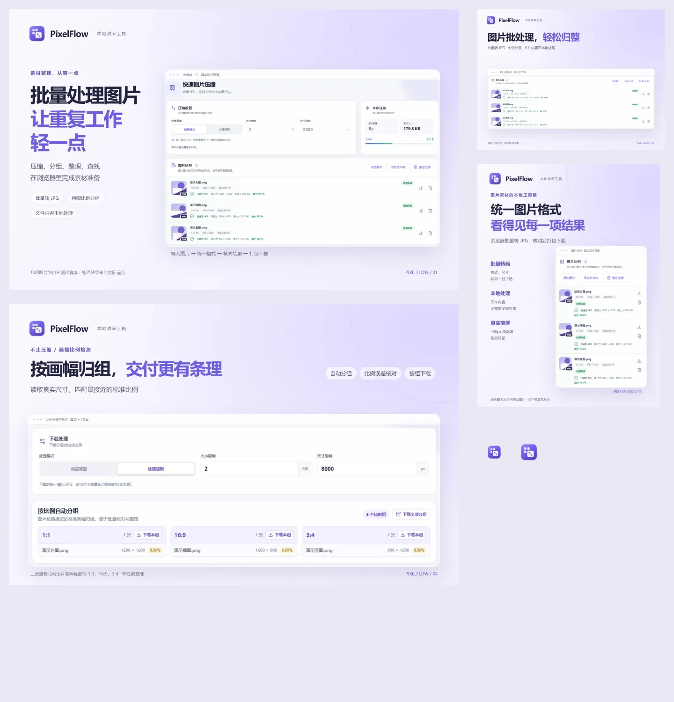

# PixelFlow · 造物集正式素材

2026-11-02 制作。产品 ID：`pixelflow`。仓库：[image-pixel-batch-reducer-lym](https://github.com/liaoyiming222-art/image-pixel-batch-reducer-lym)。集成时请固定到本批素材提交，使用本目录的相对路径；无需改造物集仓库。

| 文件 | 尺寸 | 用途 |
|---|---|---|
| [icon.svg](icon.svg) | viewBox 256 × 256 | 原样沿用正式品牌母版 |
| [icon-512.png](icon-512.png) | 512 × 512 | 透明背景产品图标 |
| [hero.webp](hero.webp) | 1920 × 1200 | 首页展台，左右分栏 |
| [card.webp](card.webp) | 1200 × 900 | 作品卡片，标题与队列上下排布 |
| [mobile.webp](mobile.webp) | 900 × 1200 | 窄屏独立构图，真实响应式队列 |
| [detail-01.webp](detail-01.webp) | 1920 × 1200 | 与主图不同的比例检测与分组功能 |

逐图尺寸、格式、SHA-256、中文 alt、用途、来源与代码指纹见 [manifest.json](manifest.json)。真实原始截图、局部裁切与展示校验图在 [sources/](sources/)，虚构测试输入和产品实际下载的 ZIP 在 [samples/](samples/)。所有媒体均随仓库保存。

## 真实能力与边界

实际启动 Vite 产品，从本地导入三张自制几何 PNG，选择“仅转格式”，完成三张转 JPG，并通过“下载全部”取得 ZIP。随后切换“比例检测与分组”，真实得到 1:1、16:9、3:4 三组。没有修改界面内容或结果数字，没有重画产品界面。宣传外框、标题、说明和背景是独立排版。

样本原始合计约 179.8 KB；具体转码大小以 ZIP 与界面为准。图内压缩率仅属于这些样本，不作平均效率或性能承诺。正式站点支持匿名数量与状态统计，“本地处理”指文件内容，不表示完全没有网络请求。

实际拍摄基准提交为 `530bdd6ebf3e42db353838db6eb5cfeabf004ece`。拍摄工作区已有查图和统计相关用户改动，完整界面输入文件指纹记录在 manifest；本次展示的压缩与比例检测代码与基准一致，用户业务改动不纳入素材提交。未测试真实共享目录权限、线上数据库、账号或部署，也没有把它们作为宣传内容。文件夹与查图能力仅经代码核对。

窄屏图来自 390px 宽桌面浏览器响应式布局，不表示手机真机验收或手机插件安装支持。所有示例为虚构图名与自制几何图，无个人数据、外站图片或付费生成服务。

## 复现排版与拍摄

源文件为 [layout.html](layout.html)、[capture.cjs](capture.cjs)、[render.cjs](render.cjs)、[verify.cjs](verify.cjs)、[runtime.cjs](runtime.cjs)。从项目根目录执行；需要 Node.js、Chrome、项目依赖以及 `playwright`、`sharp`、`jszip`。可在独立工具目录安装这些依赖，并将 `PORTFOLIO_NODE_MODULES` 指向该目录的 node_modules，不需改项目 package.json。脚本无硬编码本机路径。

1. 按项目原说明安装依赖，运行 `npm run dev -- --port 5173`。
2. `node docs/portfolio-assets/capture.cjs` 实际操作产品并更新原图、样本及 ZIP。
3. `node docs/portfolio-assets/render.cjs` 从相对路径加载素材，生成四种独立构图和 512px 图标。
4. `node docs/portfolio-assets/verify.cjs` 校验尺寸、品牌一致性、ZIP 内三张真实 JPG，生成 manifest 和展示校验图。

可设置 `PORTFOLIO_APP_URL` 与 `PORTFOLIO_BROWSER`；默认使用本地 5173 端口与 Chrome。原始拍摄采用 Windows 微软雅黑、Chrome、Playwright、Sharp；其他系统字体和浏览器版本可能导致文字或编码细节变化，提交的最终文件及其哈希为交付依据。仅重排可跳过拍摄步骤，使用随附原图。素材不依赖本机绝对路径或外部热链。

## 校验记录

已逐张检查最终图标题、边界、圆角、阴影及真实界面裁切；卡片不沿用整张桌面截图缩小，窄屏采用真正的响应式队列。校验预览覆盖 hero/detail 的 960px 展示、卡片 400px、窄屏 390px 和 32/40px 图标。小尺寸下应以宣传标题为阅读重点，详细界面信息使用原尺寸详情图。

浏览器拍摄报告无页面运行错误。未更改业务功能、部署或账号权限。既有使用文档继续保留在项目根 README。
